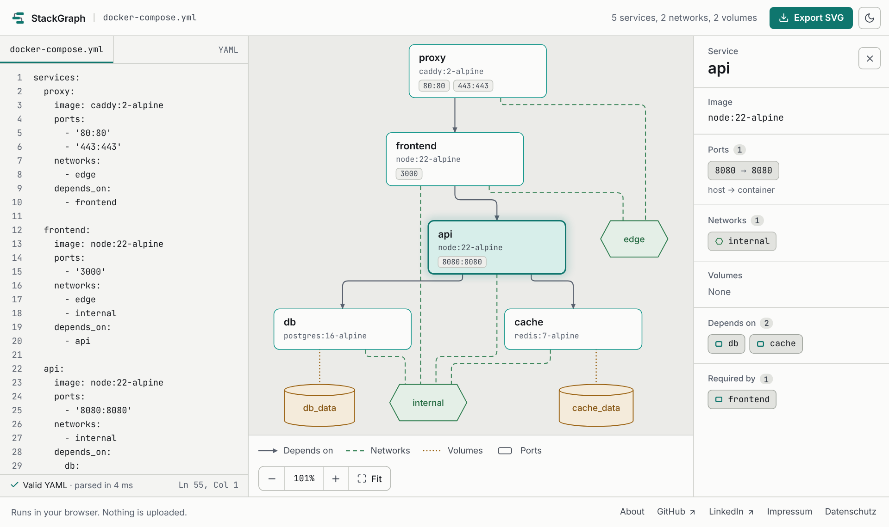
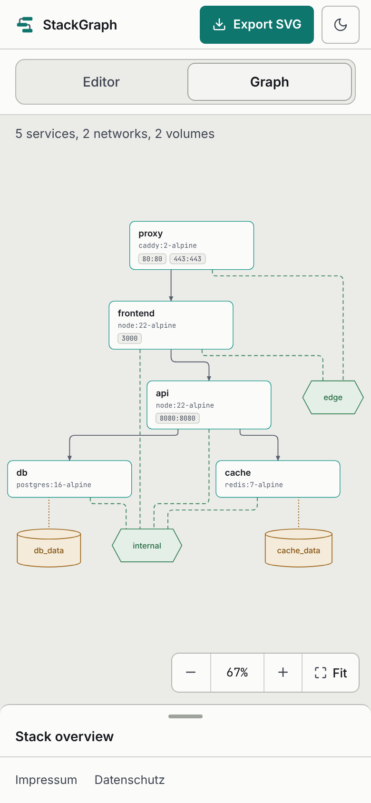

<picture>
  <source media="(prefers-color-scheme: dark)" srcset="docs/images/logo-dark.svg" />
  
</picture>

# StackGraph

Paste a `docker-compose.yml` and see it as an interactive service graph: services, dependencies,
networks, volumes and ports. Everything runs in your browser; nothing is uploaded.

**Try it at [stackgraph.tobias-klanert.de](https://stackgraph.tobias-klanert.de).** The
[About page](https://stackgraph.tobias-klanert.de/about) explains how it is built and why.


<picture>
  <source media="(prefers-color-scheme: dark)" srcset="docs/images/split-view-dark.png" />
  
</picture>

StackGraph is a portfolio project, built to show clean Angular architecture, strict TypeScript and accessible data visualization.

---

## Features

### Paste and get feedback

- An editor with line numbers and caret position. The graph follows as you type, once you pause.
- Errors say what is wrong and where, with a hint on how to fix it and a "Go to line" button.
  Meanwhile the graph keeps showing the last valid version, and says so.
- One click loads an example stack. `Ctrl+Enter` (`⌘+Enter` on a Mac) opens the graph.

### Read the stack

- Services as nodes, `depends_on` as arrows, networks and volumes as nodes of their own, ports as
  chips on each service. The layout runs top to bottom, so dependencies read in one direction.
- Node types differ by shape and line style, not by colour alone.
- Select a service to see its image, ports (host → container), networks, volumes and bind mounts,
  what it depends on and what requires it. Related services are one click away.
- Without a selection, the side panel lists the whole stack.
- Zoom and pan with mouse, touch or the zoom bar, which shows the real zoom level and fits the
  graph or resets it to 100 %.

### Take it with you

- Export the graph as SVG, styled as on screen. Fonts are not embedded yet: on a machine without
  Inter and JetBrains Mono the file falls back to system fonts.

### Wherever you open it

- Light and dark theme, following the system or chosen by hand.
- On phones and small tablets the editor and the graph get a tab each, and the details sit in a
  sheet under the graph, or beside it in landscape.

<picture>
  <source media="(prefers-color-scheme: dark)" srcset="docs/images/phone-dark.png" />
  
</picture>

---

## How it works

The compose text runs through a pipeline in which every step only knows the one before it:

1. **Parse:** `js-yaml` reads the text, and the result is checked and turned into a typed model of
   services, networks and volumes. Problems come back as readable errors with a position, not as
   exceptions.
2. **Layout:** the model becomes an ELK graph. Node sizes are computed from their content first,
   then ELK's layered algorithm places the nodes and routes the edges at right angles.
3. **Render:** Angular draws the positioned graph as plain SVG. `d3-zoom` only supplies the zoom
   and pan transform. Because the SVG is the app's own DOM, export means serialising it.
4. **State:** signals hold the state. RxJS only handles the timing: it waits for typing to pause
   and drops results of outdated input.

Parser, mapping and node geometry are plain functions, tested without Angular or a DOM. The
[About page](https://stackgraph.tobias-klanert.de/about) covers constraints, decisions and
trade-offs in detail.

---

## Privacy

- There is no backend: the compose file never leaves the browser.
- No cookies, no analytics. The fonts are self-hosted, so the page makes no third-party requests.
- The only stored item is one `localStorage` entry, and only if you choose a theme by hand.
- The container's nginx keeps no access log.

---

## Accessibility

- Every service node is a toggle button: Tab reaches it, Enter or Space selects it, Escape clears
  the selection. A skip link leads past the editor to the graph.
- The stack overview lists every service, network and volume as text, as an alternative to the
  graph. Choosing a service there works like selecting it in the graph.
- The parse result is announced through a polite live region. The error details are there to read
  and to jump to, not read out on every keystroke.
- Focus moves on purpose: to the details when a service is chosen from the panel, to the error
  when the graph cannot open on a touch screen, into the field when it cannot open with a mouse.
- Colour is never the only cue, the focus ring is always visible, and reduced motion is respected.
- On touch screens, the app's controls are at least 40 px, and the chips that select a service
  44 px.

---

## Tech stack

| Area | Choice |
| --- | --- |
| Framework | Angular 21 + TypeScript (strict) |
| YAML parsing | [`js-yaml`](https://github.com/nodeca/js-yaml) |
| Graph layout | [`elkjs`](https://github.com/kieler/elkjs) (ELK layered algorithm) |
| Rendering | Custom SVG via Angular templates |
| Pan / zoom | [`d3-zoom`](https://github.com/d3/d3-zoom) (transform only) |
| State | Signals as the source of truth; RxJS for the debounced parse → layout pipeline |
| Styling | SCSS with CSS custom properties as design tokens; no UI library |
| Testing | [Vitest](https://vitest.dev/) (jsdom) |
| Linting / formatting | ESLint (angular-eslint flat config) + Prettier |
| Container | Multi-stage Docker build (`node:24-alpine` → `nginx:alpine`) |

> **Why ELK and custom SVG instead of a graph library?** Keeping _layout_ (computing positions)
> apart from _rendering and interaction_ (drawing SVG, zoom, selection) keeps each layer simple,
> makes the SVG export trivial, and gives layered layouts that suit dependency graphs.

---

## Getting started

### Prerequisites

- **Node.js 24 LTS** (`^24.22.1`). The version is pinned in `.nvmrc` and enforced through `engines` with `engine-strict`, so `npm install` stops with a clear error on any other version. With a version manager such as fnm or nvm, `fnm use` or `nvm use` picks it up automatically. CI and the Docker build use the same version.
- **npm 11+**, **Git**, and **Docker** for the container workflow.

The Angular CLI runs through the npm scripts, so a global `@angular/cli` is optional.

### Run it locally

```bash
git clone https://github.com/TobiasKlanert/stackgraph.git
cd stackgraph
npm install
npm start
```

Open **http://localhost:4200/**. The app reloads when a source file changes.

### Production build

```bash
npm run build
```

The output in `dist/stackgraph/browser/` is plain static files for any web server.

---

## Running with Docker

The `Dockerfile` builds the app with `node:24-alpine` and serves it with `nginx:alpine`, including
the SPA fallback, long-term caching for hashed assets and revalidation for the icons.

```bash
docker build -t stackgraph .
docker run --rm -p 8080:80 stackgraph
```

Open **http://localhost:8080/** and stop the container with `Ctrl+C`.

> The `docker-compose.yml` in this repository is the production deployment: it runs behind an
> existing Caddy reverse proxy on an external Docker network named `web` and publishes no ports.
> For a local run, use the commands above.

---

## Testing and code quality

```bash
npm test              # unit tests with Vitest (jsdom, no browser needed)
npm run lint          # ESLint
npm run format        # Prettier: write changes
npm run format:check  # Prettier: check only
```

CI runs lint, format check, tests and the production build for every pull request to `main` and
every push to it.

Dependabot proposes dependency updates weekly. Angular packages are grouped into one pull request, and major updates of Angular and its coupled tooling are left to `ng update`, which runs the migrations.

The README images are rendered from a production build with
[`scripts/readme-screenshots.mjs`](scripts/readme-screenshots.mjs); the file explains how to run it.

---

## Deployment

A push to `main` that passes CI builds the Docker image, pushes it to the GitHub Container Registry
(`ghcr.io/tobiasklanert/stackgraph`, tagged `latest` and with the commit SHA), and deploys it over
SSH: the server pulls the new image and restarts the container. There it runs behind Caddy, which
handles TLS.

---

## Project structure

```
src/
├─ app/
│  ├─ core/         # parser and model, ELK mapping and node geometry, state, theme, export
│  ├─ features/
│  │  └─ graph/     # the tool: home view, editor, graph, details, the compact layout's parts
│  ├─ shared/       # header, footer, theme toggle, error box, zoom directive
│  ├─ pages/        # About, Impressum, Datenschutz: lazy-loaded with a shared document layout
│  └─ app.routes.ts
├─ styles/          # design tokens, themes, base styles, shared controls
└─ testing/         # helpers for the unit tests
scripts/            # tooling outside the app, e.g. the README images
docs/images/        # images used in this README
```

Dependencies point one way: features use `shared/` and `core/`, and `core/` uses neither.

---

## Roadmap

Version 1.0 covers everything above. The
[v1.1 milestone](https://github.com/TobiasKlanert/stackgraph/milestone/9) collects what comes next,
among other things: the ELK layout in a Web Worker so large stacks stay responsive, filter toggles
in the legend, opening a compose file from disk, PNG export, and shareable links.

---

## License

This project is licensed under the [MIT License](./LICENSE) © 2026 Tobias Klanert.
